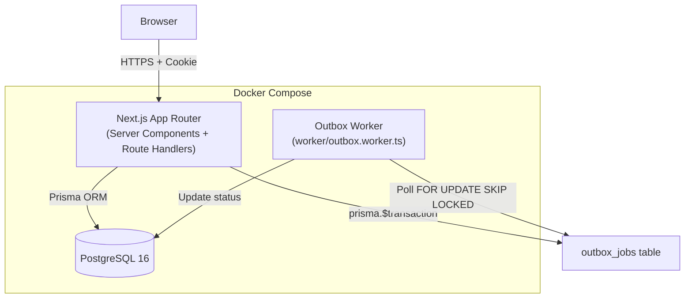
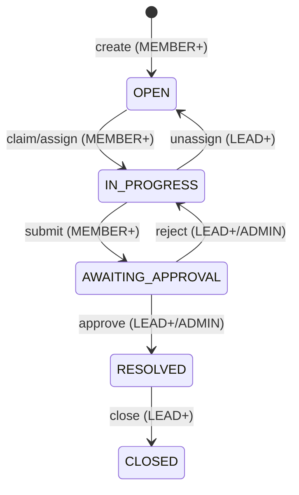

# Architecture

## System Overview



## Request Lifecycle

```
1. Browser → proxy.ts (Next.js Proxy/Middleware)
       JWT cookie verification
       → Redirect to /login if invalid/missing
       → next() if valid

2. Route Handler (app/api/**/*.ts)
       getSessionFromRequest(req)  ← 401 if missing
       getUserTeamIds(userId)       ← scope queries
       requireTeamRole(...)         ← 403 if insufficient
       validateBody(zod)            ← 400 if invalid
       services/items.service.ts    ← business logic
       prisma.$transaction(...)     ← atomic write

3. Service Layer
       WorkItem mutation
       ActivityEvent creation       ← same transaction
       OutboxJob creation           ← same transaction
       ↓
       Returns updated item to Route Handler
       ↓
       Route Handler returns JSON response
```

## Work Item State Machine



## Module Boundaries

```
lib/auth.ts           — JWT sign/verify, cookie helpers (server-only)
lib/prisma.ts         — PrismaClient singleton with PrismaPg adapter
lib/permissions.ts    — Role hierarchy, requireTeamRole(), getUserTeamIds()
lib/transitions.ts    — Allowed state machine map, requiresLead() checks
lib/idempotency.ts    — withIdempotency() wrapper for POST endpoints
lib/activity.ts       — buildActivityEvent() helper
lib/constants.ts      — Client-safe enum constants (no Prisma import)
services/             — Business logic (called from Route Handlers)
generated/prisma/     — Prisma 7 generated client (enums.ts is client-safe)
worker/               — Outbox worker (separate Node.js process)
```

## Authentication Flow

```
POST /api/auth/login
  ↓ Validate email + password (zod)
  ↓ Fetch user from DB
  ↓ bcrypt.compare(password, hash)
  ↓ On success: signToken(jose SignJWT)
  ↓ Set httpOnly, Secure, SameSite=Lax cookie
  ↓ Return { user: { id, name, email } }

Every subsequent request:
  proxy.ts → verifyToken(cookie)
  Route Handler → getSessionFromRequest(req)
                → { sub, name, email }
```

## Database Transaction Pattern

Every mutation follows this pattern:

```typescript
await prisma.$transaction(async (tx) => {
  // 1. Atomic item mutation (with version check if applicable)
  const rows = await tx.$executeRaw`UPDATE ... WHERE id = $1 AND version = $2`;
  if (rows === 0) throw conflict; // or return null for claim

  // 2. Activity event (in same transaction)
  await tx.activityEvent.create({ data: { ... } });

  // 3. Outbox job (in same transaction — transactional outbox guarantee)
  await tx.outboxJob.create({ data: { ... } });

  return updatedItem;
});
```

If any step fails, all three writes roll back together.
