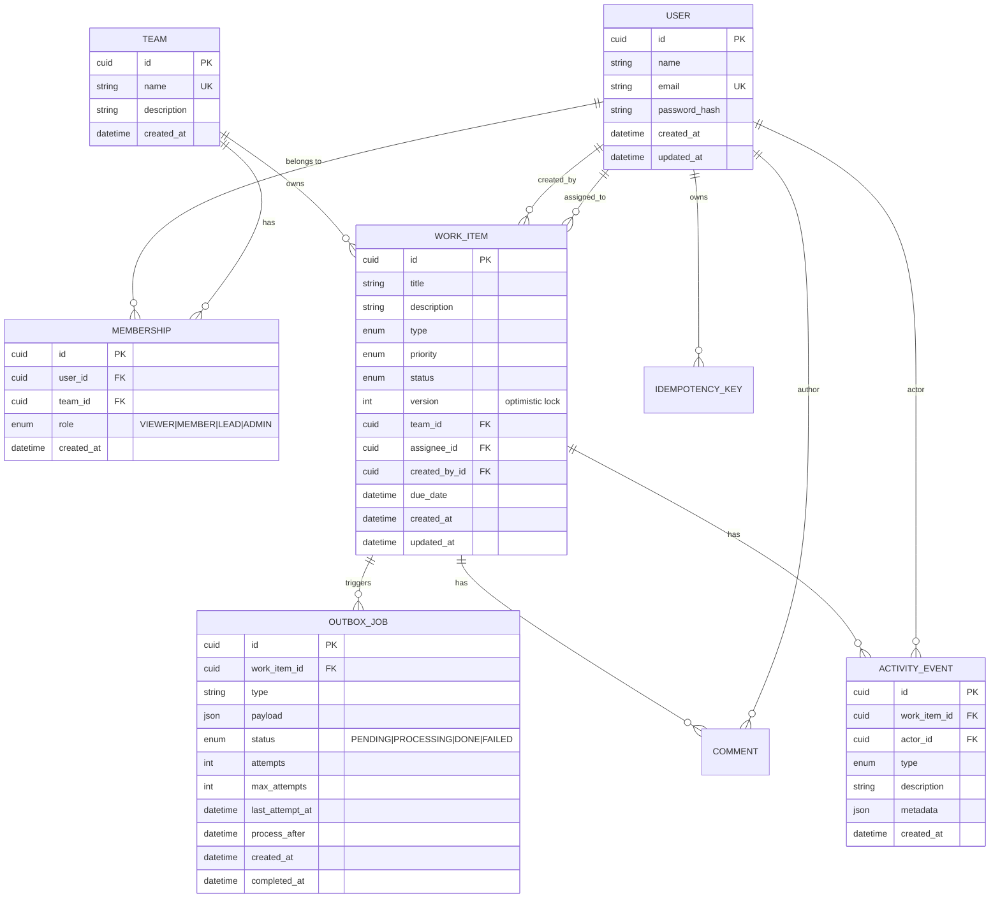

# Database Design

## Entity Relationship Diagram



## Key Design Decisions

### `version` field on `work_items`
- Starts at 1, incremented by every atomic update
- Client must send the version it last read; if it doesn't match the DB, the update returns 0 rows → 409
- This is the optimistic locking mechanism — no SELECT FOR UPDATE needed

### `activity_events` is append-only
- No UPDATE or DELETE operations are ever run on this table
- Written inside the same `$transaction` as the parent work item mutation
- This guarantees the history is always consistent with the current state

### `idempotency_keys` unique constraint
- `@@unique([key, userId])` — the same key can be reused by different users
- `statusCode = 0` means the operation is in-flight; concurrent requests wait and retry

### `outbox_jobs` polling
- `status` transitions: `PENDING → PROCESSING → DONE` (or `FAILED` after max_attempts)
- `FOR UPDATE SKIP LOCKED` in the worker prevents dual processing
- `processAfter` implements exponential backoff: `min(1000 * 2^attempts, 60000)` ms

## Indexes

```sql
-- work_items
CREATE INDEX ON work_items(status, team_id);         -- filter by status+team
CREATE INDEX ON work_items(assignee_id);              -- "assigned to me" view
CREATE INDEX ON work_items(created_at, id);           -- cursor pagination
CREATE INDEX ON work_items(team_id, status, priority);-- "unassigned urgent" view

-- activity_events
CREATE INDEX ON activity_events(work_item_id, created_at); -- timeline fetch

-- memberships
CREATE INDEX ON memberships(user_id);   -- getUserTeamIds()
CREATE INDEX ON memberships(team_id);   -- team member listing

-- outbox_jobs
CREATE INDEX ON outbox_jobs(status, process_after); -- worker polling
CREATE INDEX ON outbox_jobs(status, attempts);       -- stuck job recovery
```

## Transaction Boundaries

| Operation | What commits together |
|---|---|
| Create item | work_item row + CREATED activity_event |
| Claim item | work_item.assignee_id + version++ + ASSIGNED activity_event + ITEM_ASSIGNED outbox_job |
| PATCH item | work_item fields + version++ + ActivityEvent(s) |
| Transition | work_item.status + version++ + STATUS_CHANGED activity_event + ITEM_STATUS_CHANGED outbox_job |
| Comment | comment row + COMMENTED activity_event |
